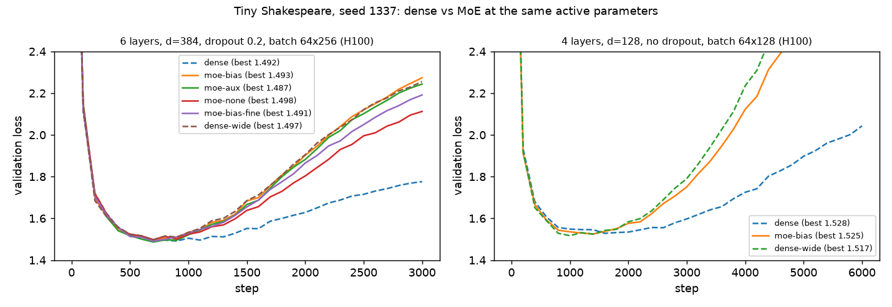
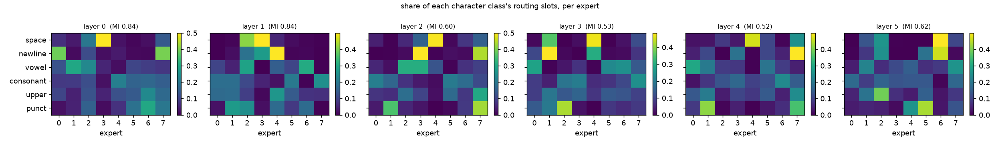

# nanomoe-transformer

[](https://colab.research.google.com/github/albertlieyingadrian/nanomoe-transformer/blob/main/notebooks/quickstart.ipynb)

The smallest readable DeepSeek-style Mixture-of-Experts transformer. One file of PyTorch (`nanomoe.py`): a
char-level GPT whose feed-forward layers are a router, 8 small experts and one shared expert, with Multi-head Latent
Attention, auxiliary-loss-free load balancing and optional multi-token prediction.

```
dense GPT block                                MoE block (same work per token)

  x                                              x
  |                                              |
[ attention ]                                  [ MLA attention ]   caches a small latent, not every key and value
  |                                              |
[ one FFN, width 3h ]                          [ router ] -- scores 8 experts, keeps the top 2
  |                                              |      \
  |                                     [ e1 ][ e2 ] ... [ e8 ]   each width h; a token visits 2
  |                                              |      /
  |                                     + [ shared expert, width h ]   every token visits it
  |                                              |
  next block                                   next block
```

A dense model is a restaurant with one big kitchen: every order goes through the same chef. An MoE model is a food
court: a host (the router) sends each order to the two stalls that suit it best, and one shared stall cooks a little
for everyone. The food court has about twice the cooks in total, but each order still costs three cooks' time. That is
the trade: more weights stored, the same compute per token.

## Quickstart

```bash
git clone https://github.com/albertlieyingadrian/nanomoe-transformer && cd nanomoe-transformer
pip install -r requirements.txt   # torch, numpy, matplotlib
python test_nanomoe.py                                  # 7 tiny checks, a few seconds
python nanomoe.py --mode compare --steps 1500           # dense vs MoE at the same active parameters, ~12 min on a laptop CPU
python nanomoe.py --mode train --steps 1500             # train one MoE on Tiny Shakespeare (downloaded on first use)
python nanomoe.py --mode sample --out out/model.pt      # sample text
python nanomoe.py --mode heatmap --out out/model.pt     # which characters go to which expert
```

Every field of `Config` is a flag: `--balance aux --n_routed 16 --top_k 4 --fine 4 --capacity_factor 1.25 --mtp 1 ...`

## The pieces

- **Router.** `softmax(W x)` scores every expert; the token goes to the top 2, weighted by their scores (rescaled
  to sum to 1). Output = shared expert + those 2 experts, scaled.
- **Load balancing.** Left alone, a router can send almost everything to a few experts (routing collapse): the rest
  learn nothing and the busy ones become a bottleneck. Two fixes are built in. `--balance aux` adds the Switch
  Transformer loss `E * sum_i f_i * P_i` (1.0 when even, E/k when collapsed). `--balance bias` (the default) is
  DeepSeek-V3's auxiliary-loss-free method: a per-expert bias, added to the scores only when choosing, nudged down
  for busy experts and up for idle ones after every step. It never touches the gradient, so it cannot trade quality
  for balance.
- **Fine-grained experts.** `--fine 4` cuts every expert into 4 narrower ones and routes to 4 times as many: the
  same weights, the same work per token, and 10 million ways to combine experts instead of 28 (DeepSeekMoE).
- **MLA.** Multi-head Latent Attention caches one small latent (plus a shared RoPE key) per token and layer instead
  of every head's keys and values: 96 + 32 numbers instead of 768 at the main run's size, 6x less memory when
  generating.
- **MTP.** `--mtp 1` adds a small block that also predicts the token after next, for more training signal per
  position (DeepSeek-V3). It is training-only and not counted in active parameters.

## Results

Real runs on Tiny Shakespeare (character-level, 1.1M characters, 90/10 split), 2026-11-26. Every row of every table
is in `results.tsv`.

**Main run**: one H100 on Modal, seeds 1337 and 1, 3,000 steps, batch 64 × 256 characters, 6 layers, `n_embd` 384,
dropout 0.2. The MoE has 8 routed experts of width 256 (top 2) and 1 shared expert; the dense model's FFN is
768 wide, so both use the same weights per token.

| model | total params | active params | best val loss, seeds 1337 / 1 | val loss at step 3000 | max load at the end | time |
|---|---|---|---|---|---|---|
| dense (same active params) | 8.3M | 8.3M | 1.492 / 1.507 | 1.776 / 1.777 | - | 1.4 min |
| MoE, bias balancing (default) | 18.9M | 8.3M | 1.493 / 1.514 | 2.274 / 2.331 | 1.39 / 1.51 | 3.5 min |
| MoE, aux loss | 18.9M | 8.3M | **1.487** / 1.507 | 2.244 / 2.282 | **1.13 / 1.10** | 3.3 min |
| MoE, no balancing | 18.9M | 8.3M | 1.498 / 1.511 | 2.113 / 2.156 | 2.35 / 2.21 | 3.3 min |
| MoE, fine-grained (32 experts, top 8, bias) | 19.0M | 8.4M | 1.491 / **1.494** | 2.191 / 2.116 | 2.38 / 2.42 | 9 min |
| dense-wide (same *total* params) | 18.9M | 18.9M | 1.497 / 1.513 | 2.256 / 2.291 | - | 1.7 min |

"Max load" is the busiest expert's share of routing slots times the number of experts: 1.0 is perfectly even, 4.0
would mean one expert in every token's top 2 (with 8 experts). Best val is the lowest of 30 evaluations along the
run; every model reached it at step 600-900.



**Smaller and longer**: the default size (4 layers, `n_embd` 128, 0.83M active / 2.0M total parameters), no dropout,
H100, batch 64 × 128, 6,000 steps. Best val loss, seeds 1337 / 1: dense **1.528 / 1.543**, MoE (bias)
**1.525 / 1.531**, dense-wide 1.517 / 1.511. On a laptop CPU (Apple M5 Max, seed 1337, batch 32, 1,500 steps,
before any overfitting): dense 1.532, MoE bias 1.531, MoE aux 1.534, MoE no balancing 1.536 (max load 1.32, 1.11,
2.40).

**Routing** (`--mode heatmap`, main-run MoE with bias balancing, seed 1337):



| layer | 0 | 1 | 2 | 3 | 4 | 5 |
|---|---|---|---|---|---|---|
| MI(character; top expert) / H(expert), trained, seed 1337 | 0.85 | 0.84 | 0.60 | 0.53 | 0.52 | 0.62 |
| same, seed 1 | 0.83 | 0.69 | 0.85 | 0.58 | 0.55 | 0.62 |
| same, untrained model | 0.57 | 0.37 | 0.23 | 0.10 | 0.06 | 0.07 |
| same, expert labels shuffled | 0.00 | 0.00 | 0.00 | 0.00 | 0.00 | 0.00 |

What this shows:

- **At the same work per token, the MoE did not beat the dense model here.** Best validation losses sit within
  0.02 of each other across every variant and both seeds, and the seed-to-seed spread is as large as any gap. The
  smaller, longer run says the same: the MoE is ahead by 0.003 and 0.012, inside the noise. A 1 MB corpus is
  exhausted long before the extra experts could pay off.
- **The extra stored weights buy memorisation, not generalisation.** After the best point, the balanced MoEs overfit like a
  dense model of their *total* size (2.24-2.33 at step 3000; dense-wide 2.26-2.29), not of their active size
  (dense: 1.78). The MoE with no
  balancing overfits the least of the MoEs (2.11-2.16): with its load piled on a few experts it is, in effect, a
  smaller model.
- **Balancing works, and costs nothing in loss at this scale.** Without it, the busiest expert ends at 2.2-2.4 times
  its fair share. The aux loss holds it at 1.1; the bias method at 1.4-1.5, with no extra loss term. Loss is the
  same within noise for all three.
- **Fine-grained experts are as good and much slower here.** 32 narrow experts (top 8) match the best loss but take
  2.6 times as long, because this file loops over experts in Python; their load is less even (2.4 out of a possible
  32), so `--bias_rate` probably needs to scale with the number of experts.
- **Experts specialise by character, and training sharpens it.** In every layer the token decides much more of the
  routing than in an untrained model, and the shuffled control is zero. Layer 0 sends spaces to one expert (half of
  all space slots, the most possible with top 2) and newlines to two others; the last layer groups spaces and
  newlines together and gives punctuation its own expert. The untrained model's routing already depends on the token
  in layer 0 (0.57), because its router reads little more than the token's embedding; the gap grows with depth.

## Files

- `nanomoe.py`: model, data, training, the dense-vs-MoE comparison, sampling, the routing heatmap.
- `test_nanomoe.py`: shapes, matched active parameters, dispatch against a token-by-token reference, the aux loss at
  its two extremes, bias balancing on a lopsided router, MLA's cache size and causality, a short training run.
- `notebooks/quickstart.ipynb`: the tests, a short comparison and the heatmap (the Colab badge above).
- `program.md`: a brief for running small experiments and logging them.
- `results.tsv`: the runs behind the tables above.

## Limitations

- Toy scale: 0.8-19M total parameters on 1 MB of Shakespeare, character-level. MoE's advantage grows with data and
  scale in the papers below; here the dataset is small enough that the bigger models overfit, so the table reports
  the best validation loss along the curve as well as the last one.
- Two seeds per row on the H100 and one on the CPU. Gaps under about 0.02 in validation loss are noise here.
- One small dataset. Whether an MoE beats a dense model at matched active parameters depends on having data to
  spare; this repo shows the machinery and the measurement, not the scaling result from the papers.
- The dispatch is a plain Python loop over experts, written to be read: no expert parallelism, no grouped GEMMs, no
  token permutation kernels. The MoE runs about 2.5 times slower per step than the dense model of the same active size
  (about 7 times with 32 fine-grained experts), the opposite of what a real MoE kernel achieves.
- The router uses softmax scores (DeepSeek-V2 style); DeepSeek-V3 uses sigmoid scores and also adds a small
  sequence-wise balance loss and node-limited routing, which are left out.

## Where to go next

- The full course this file comes from, one tested stage per piece (router, dispatch, capacity, aux loss,
  bias balancing, shared and fine-grained experts, MLA, MTP) plus an interpretability lab on routing, expert
  ablation and routing collapse: https://github.com/albertlieyingadrian/build-a-moe-transformer

## Credits and further reading

- DeepSeekMoE: Towards Ultimate Expert Specialization in Mixture-of-Experts Language Models (2024),
  https://arxiv.org/abs/2401.06066: fine-grained experts and shared experts.
- DeepSeek-V2: A Strong, Economical, and Efficient Mixture-of-Experts Language Model (2024),
  https://arxiv.org/abs/2405.04434: Multi-head Latent Attention with decoupled RoPE.
- DeepSeek-V3 Technical Report (2024), https://arxiv.org/abs/2412.19437: auxiliary-loss-free balancing at scale,
  multi-token prediction.
- Auxiliary-Loss-Free Load Balancing Strategy for Mixture-of-Experts (2024), https://arxiv.org/abs/2408.15664: the
  bias update used by `--balance bias`.
- Switch Transformers: Scaling to Trillion Parameter Models with Simple and Efficient Sparsity (2021),
  https://arxiv.org/abs/2101.03961: the load-balancing loss and the capacity factor.
- GShard: Scaling Giant Models with Conditional Computation and Automatic Sharding (2020),
  https://arxiv.org/abs/2006.16668: top-2 routing, expert capacity.
- OLMoE: Open Mixture-of-Experts Language Models (2024), https://arxiv.org/abs/2409.02060: a fully open MoE with
  analyses of routing and expert specialisation.
- nanowhale, https://github.com/huggingface/nanowhale: a ~110M DeepSeek-V4-style model trained from scratch with MLA,
  MoE, Hyper-Connections and MTP. It has no licence, so no code was taken from it.
- The shape of this repo: nanoGPT (https://github.com/karpathy/nanoGPT). No code is copied from it.
- Tiny Shakespeare comes from the char-rnn repo, https://github.com/karpathy/char-rnn, downloaded on first use.

## License

MIT
